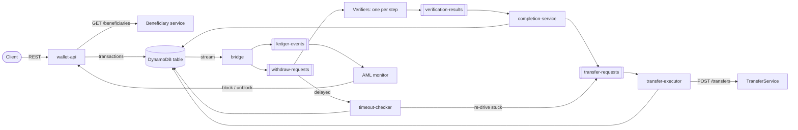
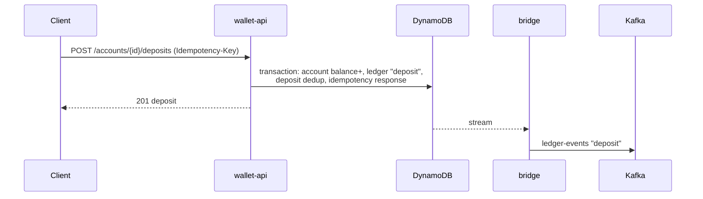
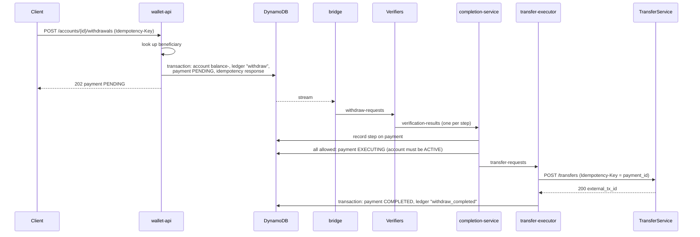
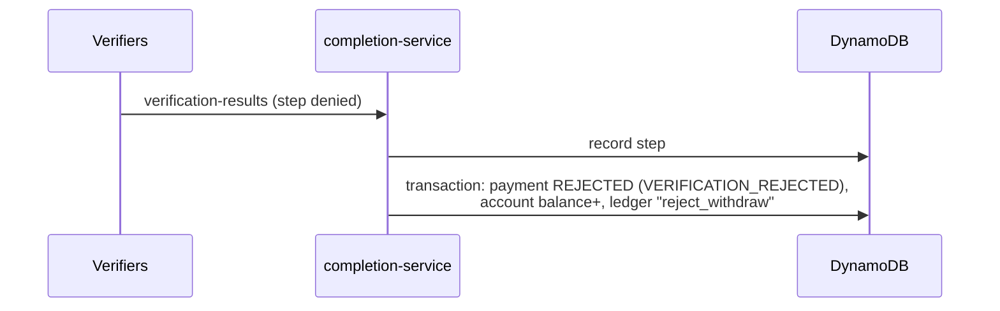
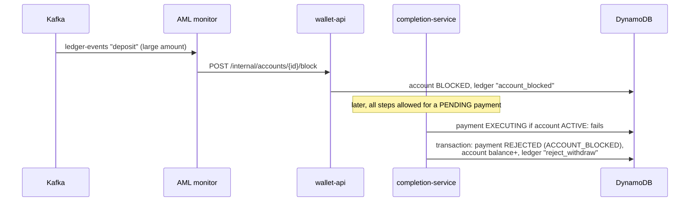
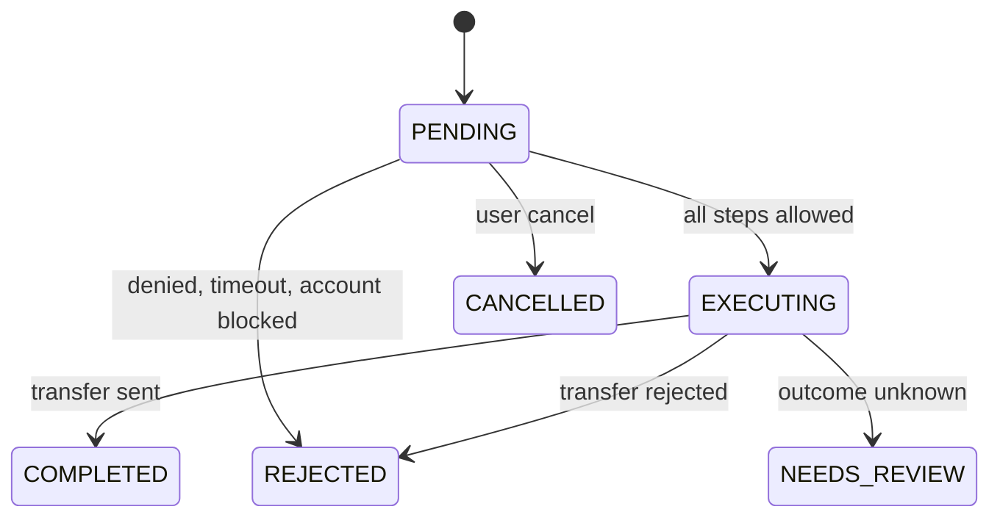

# Architecture

Money is in minor units (cents) as integers. Times are ISO-8601 UTC with milliseconds.

- [Components](#components)
- [Flows](#flows)
  - [Deposit](#deposit)
  - [Withdraw (happy path)](#withdraw-happy-path)
  - [Withdraw rejected by verification](#withdraw-rejected-by-verification)
  - [Withdraw blocked by AML](#withdraw-blocked-by-aml)
- [Payment states](#payment-states)
- [DynamoDB](#dynamodb)
  - [Costs](#costs)
- [Events (Kafka)](#events-kafka)
- [REST API](#rest-api)
  - [Endpoints](#endpoints)
  - [Response models](#response-models)
  - [Errors](#errors)

## Components



- **wallet-api**: the only entry point for clients. Writes account, ledger, payment and idempotency items in one DynamoDB transaction.
- **bridge**: reads the DynamoDB stream and publishes ledger entries to Kafka. In production it runs as a Lambda; locally it is a runner.
- **completion-service**: records each verification result. When all steps allow, it moves the payment to `EXECUTING` and publishes a transfer request. On a deny, it rejects the payment.
- **transfer-executor**: calls TransferService, then completes or rejects the payment, or marks it `NEEDS_REVIEW` when the outcome is unknown.
- **timeout-checker**: at `requested_at + 1h`, it rejects payments that are still `PENDING`. It also re-publishes `EXECUTING` payments that have been stuck for 15 minutes.
- **Verifiers, AML monitor, Beneficiary service, TransferService**: external systems, stubbed by `mocks`.

Services that write to DynamoDB share `libs/ledger-core`. The Kafka consumers use `libs/worker-pool`.

## Flows

### Deposit



The same `external_tx_id` on the same account returns the original deposit. On another account, it returns `409 duplicate_deposit`.

### Withdraw (happy path)



The money leaves the balance when the withdrawal is accepted. A reject or a cancel puts it back.

### Withdraw rejected by verification



If a step never answers, the timeout-checker does the same with `VERIFICATION_TIMEOUT`.

### Withdraw blocked by AML



New withdrawals and deposits on a blocked account get `409 account_blocked`. The user can still cancel a `PENDING` payment.

## Payment states



Account states are `ACTIVE`, `BLOCKED` (by AML) and `ON_HOLD`. An account goes `ON_HOLD` when a Kafka consumer fails on one of its records. It stays there until an internal `release`.

## DynamoDB

There is one table with string keys `PK` (hash) and `SK` (range). The stream view is `NEW_IMAGE`. TTL is on the attribute `ttl`.

| Item | PK | SK | Attributes |
|---|---|---|---|
| Account | `<account_id>` | `ACCOUNT#` | `account_id, balance, currency, status, version, pre_hold_status?, hold_refs?, created_at, updated_at` |
| Ledger entry | `<account_id>` | `LEDGER#<seq, 12 digits>` | `account_id, seq, event_type, recorded_at, balance_after, actor, reason?`, plus the per-type fields listed under ledger-events |
| Payment | `PAYMENT#<payment_id>` | `PAYMENT` | `payment_id, account_id, amount, currency, beneficiary_id, status, received_at, executing_at?, finalized_at?, reject_reason?, external_tx_id?, required_steps, verifications` |
| Idempotency | `IDEMPOTENCY#<key>` | `IDEMPOTENCY` | `request_hash, response_status, response_body, created_at, ttl` (24h) |
| Deposit dedup | `DEPOSIT#<external_tx_id>` | `DEPOSIT` | `external_tx_id, account_id, seq, created_at` |

- An account and its ledger share a partition, so `GET /accounts/{id}/ledger` is a single query.
- `version` on the account is the optimistic lock. Every account change writes the account and a new ledger entry in one transaction.
- `verifications` is a map from step to `{allowed, details?, decided_at, recorded_at, late?}`.

The examples below show values as plain JSON, without DynamoDB type wrappers.

Account:

```json
{
  "PK": "01JB8Z5X3K9QH2M7RYT4VWD6NC", "SK": "ACCOUNT#",
  "account_id": "01JB8Z5X3K9QH2M7RYT4VWD6NC",
  "balance": 7000, "currency": "USD", "status": "ACTIVE", "version": 3,
  "created_at": "2026-10-27T10:00:00.000Z", "updated_at": "2026-10-27T10:05:00.000Z"
}
```

Ledger entry:

```json
{
  "PK": "01JB8Z5X3K9QH2M7RYT4VWD6NC", "SK": "LEDGER#000000000003",
  "account_id": "01JB8Z5X3K9QH2M7RYT4VWD6NC", "seq": 3,
  "event_type": "withdraw", "recorded_at": "2026-10-27T10:05:00.000Z",
  "balance_after": 7000, "actor": "user",
  "amount": 3000, "currency": "USD", "payment_id": "01JB8ZC4R1T6E9P3XQ0M2KJHAB",
  "beneficiary": {"beneficiary_id": "b-1", "name": "Jane", "account_masked": "****9876",
                  "account_fingerprint": "hmac:2", "country": "DE"}
}
```

Payment:

```json
{
  "PK": "PAYMENT#01JB8ZC4R1T6E9P3XQ0M2KJHAB", "SK": "PAYMENT",
  "payment_id": "01JB8ZC4R1T6E9P3XQ0M2KJHAB", "account_id": "01JB8Z5X3K9QH2M7RYT4VWD6NC",
  "amount": 3000, "currency": "USD", "beneficiary_id": "b-1", "status": "PENDING",
  "received_at": "2026-10-27T10:05:00.000Z",
  "required_steps": ["aml", "account_verified", "beneficiary_credibility"],
  "verifications": {
    "aml": {"allowed": true, "decided_at": "2026-10-27T10:05:01.200Z", "recorded_at": "2026-10-27T10:05:01.250Z"}
  }
}
```

### Costs

Capacity for one operation without retries. The numbers assume:

- every item is under 1KB;
- every read is a strongly consistent GetItem (1 RCU per 4KB);
- a transactional write costs 2 WCU per item;
- there are 3 verification steps, the default `wallet.verification.steps`: `aml`, `account_verified`, `beneficiary_credibility`.

Deposit: 2 RCU, 8 WCU.

| Step | RCU | WCU |
|---|---|---|
| API: idempotency lookup (miss) | 1 | |
| API: read account | 1 | |
| API: transaction with 4 items (account, ledger entry, deposit dedup, idempotency) | | 8 |

Withdrawal, end to end: 6 RCU, 21 WCU.

| Step | RCU | WCU |
|---|---|---|
| API: idempotency lookup (miss) | 1 | |
| API: read account | 1 | |
| API: transaction with 4 items (account, ledger entry, payment, idempotency) | | 8 |
| completion-service: record each verification step (plain UpdateItem, 1 WCU each) | | 3 |
| completion-service: move to `EXECUTING`, a transaction with a ConditionCheck on the account plus the payment update | | 4 |
| transfer-executor: read payment, read it again in `complete()`, read account | 3 | |
| transfer-executor: transaction with 3 items (account, ledger entry, payment) | | 6 |
| timeout-checker after 1h: read payment, finds it final, stops | 1 | |

Not counted:

- Verifiers and the AML monitor don't touch DynamoDB.
- Recording a step returns the item (`ALL_NEW`) without a read cost.
- The bridge reads the stream, which doesn't use table RCU.

The executor reads the same payment twice. Passing the `Payment` into `complete`, as `reject` already does, would save 1 RCU.

At the peak of 20k requests/s (80% withdrawals, 20% deposits), the table needs about 104k RCU/s and 368k WCU/s. That is a peak, not the average load, so production should use provisioned capacity with autoscaling: it is sized for the base load and scales up toward the peak. Paying for the peak around the clock would waste most of that capacity.

Rough monthly cost if the peak lasted all month (us-east-1 list prices, DynamoDB only). This is an upper bound, and cost scales linearly with the average load:

| Mode | Cost/month |
|---|---|
| On-demand (\$0.625 per million writes, \$0.125 per million reads) | ~\$638k (writes ~\$604k, reads ~\$34k) |
| Provisioned at 100% use (\$0.00065 per WCU-hour, \$0.00013 per RCU-hour) | ~\$185k |
| Provisioned at a 70% autoscaling target | ~\$264k |
| Reserved capacity | up to 54% off provisioned (1-year term), up to 77% (3-year) |

How these figures were calculated (a month is 730 hours, or about 2.63M seconds):

- Load: 16k withdrawals/s × (6 RCU, 21 WCU) + 4k deposits/s × (2 RCU, 8 WCU) = 104k RCU/s and 368k WCU/s.
- On-demand writes: 368k × 2.63M s = 967 billion units, × \$0.625 per million = ~\$604k.
- On-demand reads: 104k × 2.63M s = 273 billion units, × \$0.125 per million = ~\$34k.
- Provisioned writes: 368k WCU × \$0.00065 × 730 h = ~\$175k. Reads: 104k RCU × \$0.00013 × 730 h = ~\$10k. Together ~\$185k.
- 70% autoscaling target: \$185k / 0.7 = ~\$264k.
- Storage: (16k × 1.7KB + 4k × 0.9KB) per second × 2.63M s = ~80TB a month, × \$0.25 per GB = ~\$20k.

Prices: [DynamoDB on-demand pricing](https://aws.amazon.com/dynamodb/pricing/on-demand/) and [provisioned pricing](https://aws.amazon.com/dynamodb/pricing/provisioned/), us-east-1, checked on 2026-10-27.

Storage adds to that and keeps growing. A withdrawal keeps about 1.7KB and a deposit about 0.9KB, so this load adds about 80TB a month, or about \$20k/month more storage cost every month at \$0.25/GB-month. Archiving old ledger and payment items, or the Standard-IA table class, keeps this in check. Kafka, compute, Lambda, data transfer and backups are not included.

## Events (Kafka)

All payloads are JSON with `schema_version: 1`.

| Topic | Key | Producer | Consumers | Payload |
|---|---|---|---|---|
| `ledger-events` | account_id | bridge | AML monitor | `LedgerEvent` |
| `withdraw-requests` | payment_id | bridge | verifiers (one group per step), timeout-checker (delayed) | `payment_id, account_id, seq, amount, currency, beneficiary{...}, requested_at` |
| `verification-results` | payment_id | verifiers | completion-service | `event_id, payment_id, step, allowed, details?, decided_at` |
| `transfer-requests` | payment_id | completion-service, timeout-checker | transfer-executor | `event_id, payment_id, account_id, amount, currency, beneficiary_id` |

`LedgerEvent` is one message per ledger entry. It also carries the `event_type` header.

- Common fields: `account_id, seq, event_type, recorded_at, balance_after, actor, reason?`

| event_type | Extra fields |
|---|---|
| `account_created`, `account_blocked`, `account_unblocked` | - |
| `deposit` | `amount, currency, external_tx_id, payer{payer_id, name, account_masked, account_fingerprint, country}` |
| `withdraw` | `amount, currency, payment_id, beneficiary{beneficiary_id, ...}` |
| `withdraw_completed` | `payment_id, external_tx_id` |
| `user_cancel_withdraw` | `amount, currency, payment_id` |
| `reject_withdraw` | `amount, currency, payment_id, verifier?`, with the reject reason in `reason` |
| `account_held` | `hold_ref, prior_status` |
| `account_released` | `released_to` |

`actor` is one of `user, completion-service, transfer-executor, timeout-checker, bridge, aml, internal`.

`ledger-events` (`event_type: withdraw`):

```json
{
  "schema_version": 1, "account_id": "01JB8Z5X3K9QH2M7RYT4VWD6NC", "seq": 3,
  "event_type": "withdraw", "recorded_at": "2026-10-27T10:05:00.000Z",
  "balance_after": 7000, "actor": "user",
  "payment_id": "01JB8ZC4R1T6E9P3XQ0M2KJHAB", "amount": 3000, "currency": "USD",
  "beneficiary": {"beneficiary_id": "b-1", "name": "Jane", "account_masked": "****9876",
                  "account_fingerprint": "hmac:2", "country": "DE"}
}
```

`withdraw-requests`:

```json
{
  "schema_version": 1, "payment_id": "01JB8ZC4R1T6E9P3XQ0M2KJHAB",
  "account_id": "01JB8Z5X3K9QH2M7RYT4VWD6NC", "seq": 3, "amount": 3000, "currency": "USD",
  "beneficiary": {"beneficiary_id": "b-1", "name": "Jane", "account_masked": "****9876",
                  "account_fingerprint": "hmac:2", "country": "DE"},
  "requested_at": "2026-10-27T10:05:00.000Z"
}
```

`verification-results`:

```json
{
  "event_id": "01JB8ZC5A2B3C4D5E6F7G8H9JK", "schema_version": 1,
  "payment_id": "01JB8ZC4R1T6E9P3XQ0M2KJHAB", "step": "account_verified",
  "allowed": false, "details": "document expired", "decided_at": "2026-10-27T10:05:02.000Z"
}
```

`transfer-requests`:

```json
{
  "event_id": "01JB8ZC6M7N8P9Q0R1S2T3V4WX", "schema_version": 1,
  "payment_id": "01JB8ZC4R1T6E9P3XQ0M2KJHAB", "account_id": "01JB8Z5X3K9QH2M7RYT4VWD6NC",
  "amount": 3000, "currency": "USD", "beneficiary_id": "b-1"
}
```

## REST API

The API is on port 8080 and uses JSON with snake_case. Null fields are left out.

Every `POST` needs an `Idempotency-Key` header (1-128 characters):

- The same key with the same request replays the stored response.
- The same key with a different body or path returns `409 idempotency_mismatch`.
- Keys are kept for 24h.

### Endpoints

| Method | Path | Request body | Success |
|---|---|---|---|
| POST | `/accounts` | `{currency?}` (default `USD`) | 201 Account |
| GET | `/accounts/{id}` | - | 200 Account |
| GET | `/accounts/{id}/ledger?before_seq=&limit=` | - | 200 LedgerPage (limit 1-200, default 50, newest first) |
| POST | `/accounts/{id}/deposits` | `{amount, currency?, external_tx_id, payer{payer_id, name, account_masked, account_fingerprint, country}}` | 201 Deposit |
| POST | `/accounts/{id}/withdrawals` | `{amount, currency?, beneficiary_id}` | 202 Payment |
| GET | `/payments/{id}` | - | 200 Payment |
| POST | `/payments/{id}/cancel` | none | 200 Payment (only while `PENDING`) |
| POST | `/internal/accounts/{id}/block` | `{reason}` | 200 Account |
| POST | `/internal/accounts/{id}/unblock` | `{reason}` | 200 Account |
| POST | `/internal/accounts/{id}/release` | `{to: ACTIVE\|BLOCKED, confirm?, reason}` | 200 Account |

`/internal/*` is for AML and operators, not for clients. Releasing to `ACTIVE` an account that was `BLOCKED` before the hold needs `confirm: true`.

### Response models

| Model | Fields |
|---|---|
| Account | `account_id, balance, currency, status, version` |
| Deposit | `account_id, seq, amount, currency, balance_after, external_tx_id` |
| Payment | `payment_id, account_id, amount, currency, beneficiary_id, status, received_at, executing_at?, finalized_at?, reject_reason?, external_tx_id?, required_steps[], verifications{step: {allowed, details?, decided_at, recorded_at, late?}}` |
| LedgerPage | `entries[]` (same fields as `LedgerEvent`), `next_before_seq?` |

### Errors

Errors are RFC 9457 problem details, sent as `application/problem+json`. The body is `{type, title, status, detail, error}`, where `error` is a stable code.

| Status | error |
|---|---|
| 400 | `invalid_request, invalid_amount, invalid_currency, currency_mismatch` |
| 404 | `not_found` |
| 409 | `account_blocked, account_on_hold, account_not_on_hold, confirm_required, invalid_transition, not_cancellable, duplicate_deposit, idempotency_mismatch` |
| 422 | `insufficient_funds` |
| 503 | `lock_retries_exhausted, store_unavailable, beneficiary_unavailable` (retry with the same key) |
| 500 | `internal_error` |

4xx responses are stored under the idempotency key. 5xx responses are not stored, so a retry runs the request again.
