# Wallet & Payments System — Spec

Status: design agreed, ready for implementation planning.
This is the original design. Agreed changes are listed in the [implementation plan](implementation-plan.md#2-spec-changes); the current schema, events and API are in [ARCHITECTURE.md](ARCHITECTURE.md).
Style: brief, plain English. Diagrams in Mermaid.

---

## 1. Goal

- Learning project: a production-grade wallet/payments system.
- Track wallet balances and a full audit ledger.
- Operations: deposit, withdraw, cancel withdraw.
- Scale target: ~10k operations/sec overall.
- Balance must never go negative.
- Ledger is append-only. Mistakes are fixed with new (compensating) entries, never edits.

## 2. Scope

**In scope**
- Wallet API (REST)
- DynamoDB table (accounts, ledger, payments, idempotency)
- DynamoDB Streams → Kafka bridge
- Verification flow (verifiers are mocks)
- Completion service (saga coordinator)
- Timeout checker
- Payment status API

**Out of scope (external, mocked, fixed interfaces)**
- Authentication
- User/profile service (owns full user data)
- Beneficiary service (owns full beneficiary bank details)
- Payment provider (sends deposit notifications)
- TransferService (actually sends withdrawal money)
- AML service (watches events, can block accounts)
- Verification services (return allow/reject after random latency)

---

## 3. Architecture

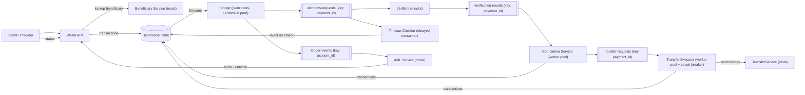

---

## 4. Key decisions (summary)

- Single DynamoDB table.
- Withdrawals deduct the balance immediately. No separate "held" amount.
- Refunds (cancel / reject) are new ledger entries that add money back.
- Every account change = one DynamoDB transaction (balance + ledger entry + payment + idempotency).
- Optimistic locking on `ACCOUNT#` via `version`. Each change bumps version by 1.
- Ledger entry sort key = new version, zero-padded to 12 digits → gap-free per-account sequence.
- Deposits: instant and final. No verification.
- Withdrawals: async. Verified, then executed via TransferService, then completed.
- Payment item has its own partition (`PAYMENT#<payment_id>`). Payment ID does not reveal account ID.
- Completion service = plain Kafka consumer (no Kafka Streams) with a worker pool keyed by `payment_id`.
- Transfers run in a separate Transfer Executor (own worker pool, retries, circuit breaker).
- Required verification steps are stored on the payment at creation (config changes don't affect in-flight payments).
- Move to `EXECUTING` is conditioned on every required step being `allowed = true`.
- Verification timeout = delayed Kafka consumer.
- Only the completion service writes verification results to DynamoDB.
- Assumption: no hot accounts.

### Tech stack

- Java 25, Spring Boot 4, virtual threads enabled (`spring.threads.virtual.enabled=true`)
- Micrometer + Prometheus registry (via Actuator)
- Resilience4j (circuit breaker, retries with backoff + jitter)
- AWS SDK v2 (DynamoDB)
- Plain Kafka clients, no Spring Kafka (custom poll loop + worker pool, not `@KafkaListener`)
- Tracing: Micrometer Tracing + OpenTelemetry exporter
- Hexagonal architecture (ports and adapters), enforced with ArchUnit tests

### Code structure (hexagonal)

- **Domain:** wallet, ledger, payment state rules. Plain Java. No Spring, AWS SDK, Kafka or Micrometer imports.
- **Application:** use cases (deposit, withdraw, cancel, record verification result, execute transfer, timeout). Depends only on domain and ports.
- **Ports:** interfaces owned by the core, e.g. account/ledger repository, event publisher, transfer gateway, beneficiary lookup, clock, metrics.
- **Adapters:** REST controllers, DynamoDB repository, Kafka consumers/producers, TransferService and Beneficiary clients, Micrometer metrics.
- ArchUnit rules (run as unit tests):
  - domain depends on nothing outside domain (and the JDK)
  - application depends only on domain and ports
  - adapters depend on ports, never on each other
  - no framework annotations (Spring, AWS, Kafka) in domain or application
  - no cycles between packages

### Virtual threads notes

- Use blocking (sync) clients: AWS SDK v2 sync DynamoDB client, plain HTTP clients. Simpler code, scales fine on virtual threads.
- Virtual threads are effectively unlimited; downstream limits are not. Size the DynamoDB HTTP connection pool explicitly and cap concurrency to external services (Resilience4j bulkhead or a semaphore), or requests pile up waiting for connections.
- Java 25: `synchronized` no longer pins virtual threads. Native calls still can — watch for pinning in load tests (`jdk.VirtualThreadPinned` JFR event).
- Kafka consumer is not thread-safe: only the poll loop thread touches it. Workers hand results back to the offset tracker.
- Worker pool keeps one queue per worker keyed by `payment_id`; virtual threads don't preserve order on their own.
- All POSTs require an `Idempotency-Key` header.
- Money = integer minor units (cents). Default currency USD.

---

## 5. Data model (single table)

### 5.1 Items

| PK | SK | What |
|---|---|---|
| `<account_id>` | `ACCOUNT#` | balance, status, version |
| `<account_id>` | `PROFILE#` | static account data |
| `<account_id>` | `LEDGER#<seq, 12 digits>` | one ledger entry |
| `PAYMENT#<payment_id>` | `PAYMENT#` | withdrawal state |
| `IDEMPOTENCY#<key>` | `IDEMPOTENCY#` | stored request hash + response |

- Sort key is a String. Sequence must be zero-padded: `LEDGER#000000000123`.
- No LSIs (they cap a partition at 10 GB).

### 5.2 `ACCOUNT#`

- `balance` — integer, minor units
- `currency` — e.g. `USD`
- `status` — `ACTIVE` | `BLOCKED`
- `version` — integer, starts at 1
- `created_at`, `updated_at`

### 5.3 `PROFILE#`

- Static data only (minimal for now). Never part of money transactions.

### 5.4 `LEDGER#<seq>` — common fields

- `account_id`
- `seq` — number (same value as in SK)
- `event_type`
- `timestamp` — server time, UTC, ISO-8601 with ms
- `balance_after`
- `actor` — who/what caused it (user, completion-service, timeout-checker, aml)
- `reason` — optional
- `payment_id` — on withdrawal-related events
- GSI1 attributes (see 5.8)

### 5.5 Ledger event types

| Event | Balance effect | Extra fields |
|---|---|---|
| `account_created` | set to 0 (seq 1) | — |
| `deposit` | + amount | `amount`, `currency`, `external_tx_id`, `payer` |
| `withdraw` | − amount | `amount`, `currency`, `payment_id`, `beneficiary` |
| `withdraw_completed` | none | `payment_id`, `external_tx_id` (from TransferService) |
| `user_cancel_withdraw` | + amount | `amount`, `currency`, `payment_id` |
| `reject_withdraw` | + amount | `amount`, `currency`, `payment_id`, `reason`, `verifier` (if relevant) |
| `account_blocked` | none | `reason`, `actor` |
| `account_unblocked` | none | `reason`, `actor` |

`reject_withdraw` reasons:
- `VERIFICATION_REJECTED` (+ which verifier)
- `VERIFICATION_TIMEOUT`
- `ACCOUNT_BLOCKED` (blocked while in flight)
- `EXECUTION_FAILED` (TransferService clearly failed)

Counterparty (same shape both ways):
- `beneficiary` (withdraw): `beneficiary_id`, `name`, `account_masked`, `account_fingerprint`, `country`
- `payer` (deposit): `payer_id`, `name`, `account_masked`, `account_fingerprint`, `country`
- `account_fingerprint` = keyed hash (HMAC) of full account number. Computed by the external service, never by us.
- Full account numbers never stored in our table or sent to Kafka.

### 5.6 `PAYMENT#<payment_id>`

- `payment_id` — ULID, opaque
- `account_id`, `amount`, `currency`, `beneficiary_id`
- `status` — see state diagram
- `received_at` — when the HTTP request arrived (for end-to-end metrics)
- `created_at`, `finalized_at` (set when final)
- `reject_reason` — when rejected
- `external_tx_id` — from TransferService
- `required_steps` — list of verification steps, copied from config at creation. Never changed.
- `verifications` — map, created empty `{}` on creation. One entry per step:
  - `allowed` — bool
  - `details` — free text, optional
  - `decided_at` — verifier's time
  - `recorded_at` — completion service's time
  - `late` — **only present** (as `true`) if recorded after the payment was final. Not written otherwise.

### 5.7 `IDEMPOTENCY#<key>`

- `request_hash`
- `response` (stored so retries get the same answer)
- `created_at`
- `ttl` — 24h (DynamoDB TTL)

### 5.8 GSI1 (sparse, ledger items only)

- `GSI1PK` = `account_id`
- `GSI1SK` = `timestamp` (ISO, UTC)
- Used for ledger date-range queries. Eventually consistent — fine for history.

### 5.9 Payment states

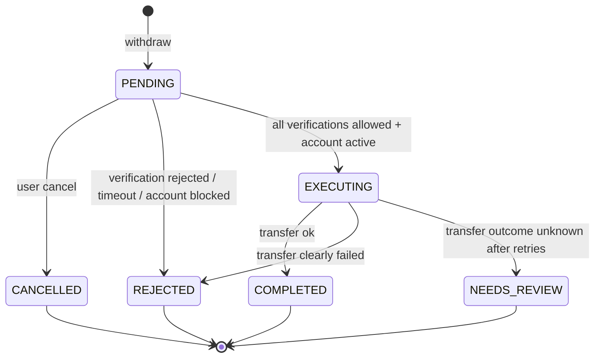

- Final states: `COMPLETED`, `REJECTED`, `CANCELLED`, `NEEDS_REVIEW` (resolved manually — TODO).
- `EXECUTING` and `NEEDS_REVIEW` are status changes only: no ledger entry, no version bump.

---

## 6. Write rules

### 6.1 Standard write pattern (optimistic locking)

1. Strongly consistent read of `ACCOUNT#` → balance, status, version N.
2. Check in code (active? enough balance?).
3. `TransactWriteItems`:
   - Update `ACCOUNT#`: new balance, `version = N+1`. Condition: `version = N` (+ status/balance conditions as safety net).
   - Put `LEDGER#<N+1>`. Condition: `attribute_not_exists`.
   - Put/update `PAYMENT#` if relevant (with status condition).
   - Put `IDEMPOTENCY#` if from API. Condition: `attribute_not_exists`.
4. On conflict: re-read, retry. Max retries configurable (default 3), random backoff. Then fail (`503`).

### 6.2 Transactions per operation

| Operation | ACCOUNT# | LEDGER | PAYMENT# | IDEMPOTENCY |
|---|---|---|---|---|
| Create account | put, version 1, cond. not exists | `account_created` | — | yes |
| Deposit | +amount, cond. ACTIVE | `deposit` | — | yes |
| Withdraw | −amount, cond. ACTIVE and balance ≥ amount | `withdraw` | put `PENDING` | yes |
| User cancel | +amount | `user_cancel_withdraw` | cond. `PENDING` → `CANCELLED` | yes |
| Mark executing | condition check only: ACTIVE (no update) | — | cond. `PENDING` and every required step `allowed = true` → `EXECUTING` | — |
| Complete | version bump only | `withdraw_completed` | cond. `EXECUTING` → `COMPLETED` | — |
| Reject (verification / timeout / blocked) | +amount | `reject_withdraw` | cond. `PENDING` → `REJECTED` | — |
| Reject (execution failed) | +amount | `reject_withdraw` | cond. `EXECUTING` → `REJECTED` | — |
| Needs review | — | — | cond. `EXECUTING` → `NEEDS_REVIEW` | — |
| Block / unblock | status change + version bump | `account_blocked` / `account_unblocked` | — | — |

Rules:
- Every `ACCOUNT#` change bumps version and writes exactly one ledger entry.
- Block stops user operations (deposit, withdraw). System refunds still work on blocked accounts.
- User cancel allowed only while `PENDING`.
- Cancel vs. execute race: both conditioned on `PENDING` → exactly one wins.
- Mark executing includes an `ACCOUNT#` condition check (ACTIVE). If blocked → reject with `ACCOUNT_BLOCKED`.
- Mark executing condition lists each step from `required_steps` explicitly, e.g. `verifications.aml.allowed = true AND verifications.account_verified.allowed = true`. A reject written by a concurrent worker always blocks execution.
- After `EXECUTING`, a block does not stop the payment.

---

## 7. Kafka

| Topic | Key | Content | Consumers |
|---|---|---|---|
| `ledger-events` | `account_id` | every ledger entry | AML (mock), future read models |
| `withdraw-requests` | `payment_id` | `withdraw` entries only | verifiers, timeout checker |
| `verification-results` | `payment_id` | verifier results | completion service |
| `transfer-requests` | `payment_id` | approved payments to execute | transfer executor |

- Partition count: generous from the start (e.g. 64–128). Increasing it later remaps keys.
- Topics no longer need matching partition counts (no Kafka Streams joins).
- Delivery is at-least-once. Every consumer must handle duplicates.
- Commit offsets only after processing.

Verification result message:
- `payment_id`, `step` (e.g. `aml`), `allowed`, `details` (optional), `decided_at`

Transfer request message:
- `payment_id`, `account_id`, `amount`, `currency`, `beneficiary_id`

Consumer settings (completion, transfer executor):
- small `max.poll.records`
- cooperative-sticky partition assignor
- static membership (`group.instance.id`) to avoid rebalances on restarts/deploys

---

## 8. Components

### 8.1 Bridge (DynamoDB Streams → Kafka)

- Logic in a plain class. Prod: thin Lambda wrapper. Tests and local runs: loop reading the DynamoDB Local stream.
- Only new (`INSERT`) items with SK starting `LEDGER#`. Ignore everything else.
- Publish to `ledger-events`. If `withdraw`, also to `withdraw-requests`.
- Retries can cause duplicates — acceptable.

### 8.2 Verifiers (mocks)

- Configurable list of steps (e.g. `aml`, `account_verified`, `beneficiary_credibility`).
- Consume `withdraw-requests`, wait random latency, publish result.
- Never write to DynamoDB.

### 8.3 Completion service (saga coordinator)

- Kafka consumer on `verification-results`, using the worker pool (8.4).
- Required steps come from `PAYMENT#.required_steps`, not from config.
- Never calls TransferService. Stays fast: only DynamoDB work.
- Per result:
  1. Read `PAYMENT#`.
  2. If this step already recorded → don't rewrite (duplicate).
  3. Else write the result to `verifications.<step>` (cond. not already set). If payment is already final → add `late: true`, do nothing else.
  4. Evaluate:
     - Any step rejected and payment `PENDING` → reject (`VERIFICATION_REJECTED`).
     - All required steps allowed and `PENDING` → mark `EXECUTING` (conditioned on each required step) → publish to `transfer-requests`.
     - Already `EXECUTING` (redelivery after crash) → publish to `transfer-requests` again. Executor handles duplicates.
  5. Mark offset done.
- Correctness never relies on one-at-a-time processing. Conditional writes protect every transition. Key ordering only avoids wasted work.

### 8.4 Worker pool (used by completion service and transfer executor)

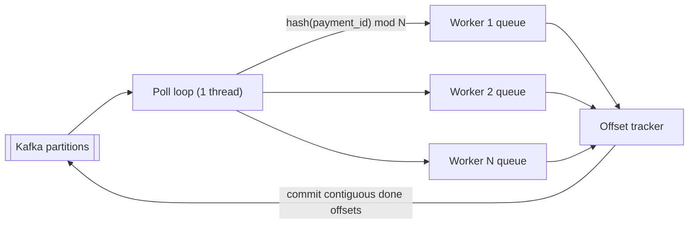

- One poll thread. Dispatches each record to a worker by `hash(payment_id) mod N`.
- Each worker has its own queue and processes one record at a time → per-payment ordering kept.
- Many payments from one partition run in parallel across workers.
- Offset tracker, per partition:
  - remembers which offsets are done
  - commits only up to the highest offset where everything before it is done
  - crash → everything after the committed offset is redelivered (handled by idempotency)
- Backpressure: queues are bounded. When full, pause the partitions. Resume when drained. Poll loop keeps calling `poll()` so the consumer stays in the group.
- On partition revoke (rebalance):
  - stop dispatching records from revoked partitions
  - wait briefly for in-flight work on them, then commit what is done
  - unfinished records are redelivered to the new owner → safe due to conditional writes and idempotency

### 8.5 Transfer executor

- Kafka consumer on `transfer-requests`, using the worker pool (8.4).
- Per request:
  1. Read `PAYMENT#`. If not `EXECUTING` → skip (already final or duplicate).
  2. Call TransferService with `payment_id` as idempotency key.
  3. Outcome:
     - Success → complete (ledger `withdraw_completed`, `PAYMENT#` → `COMPLETED`).
     - Clear failure → reject (`EXECUTION_FAILED`), no retry.
     - Unknown outcome (timeout, connection error) → retry: 3–5 attempts (configurable), exponential from 5s, with jitter.
     - Still unknown → `NEEDS_REVIEW`. **Never auto-refund** (money may have been sent).
- Retries occupy one worker, not the whole partition.
- Circuit breaker around TransferService:
  - Opens after repeated failures (configurable threshold).
  - While open: don't call TransferService, pause partitions. Payments wait; this does **not** count as a retry attempt and does **not** lead to `NEEDS_REVIEW`.
  - After a cool-down: half-open, try a few calls. Success → close and resume. Failure → open again.
- Crash mid-transfer → request redelivered → payment still `EXECUTING` → call again with same key.

### 8.6 Timeout checker

- Separate consumer group on `withdraw-requests`.
- For each event: pause partition until `event time + timeout` (default 1h, configurable). Use pause/resume, not sleep.
- Then read `PAYMENT#`. If still `PENDING` → reject (`VERIFICATION_TIMEOUT`). Conditional write makes races harmless.
- Commit after processing. Survives restarts. Long outage = late but correct timeouts.
- ~1h consumer lag is normal. Exclude from lag alerts.
- Kafka retention must exceed max downtime + timeout.

### 8.7 AML service (mock)

- Consumes `ledger-events` (deposits and withdrawals).
- Can block/unblock accounts via internal API.

### 8.8 Scaling

| Component | How it scales | Limit |
|---|---|---|
| Wallet API | stateless, add instances | DynamoDB capacity |
| Verifiers | consumer group | partitions of `withdraw-requests` |
| Completion | consumer group + worker pool | partitions × workers per instance |
| Transfer executor | consumer group + worker pool | partitions × workers; TransferService capacity |
| Timeout checker | consumer group | partitions of `withdraw-requests` |

- All state is in DynamoDB. Any instance can handle any payment.
- Rebalances are safe (redelivery + conditional writes + idempotency), just wasteful. Settings in section 7 keep them rare.
- Assumption: no hot accounts, so optimistic lock conflicts stay rare. Completion and executor still retry on conflict like the API.

---

## 9. Flows

### 9.1 Create account

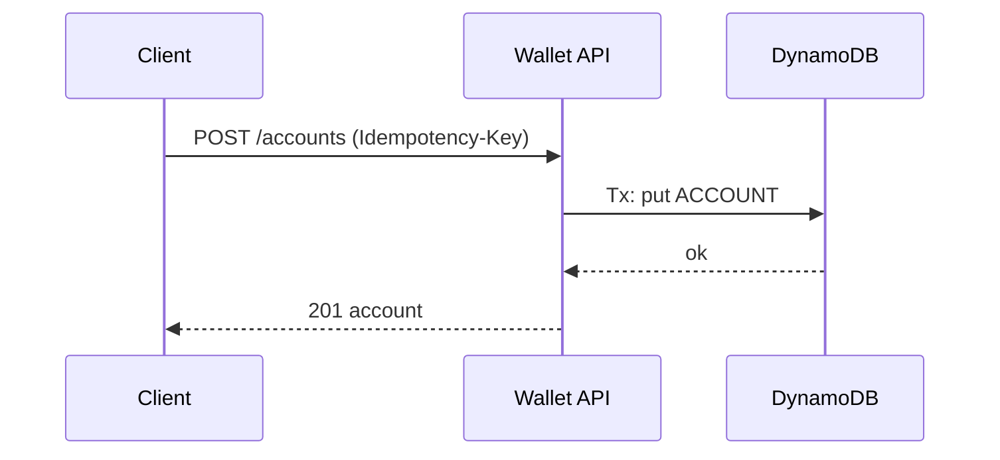

### 9.2 Deposit

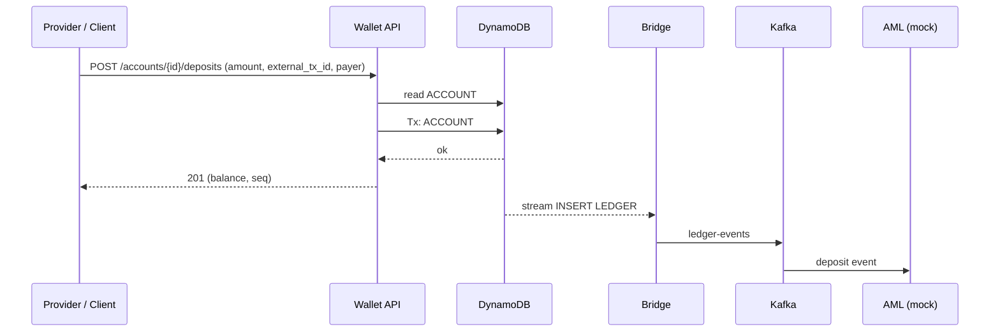

### 9.3 Withdraw — happy path

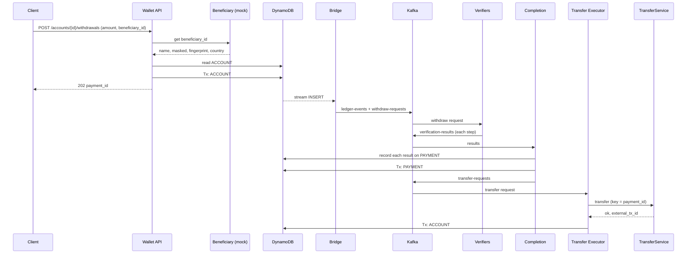

### 9.4 Withdraw — verification rejected

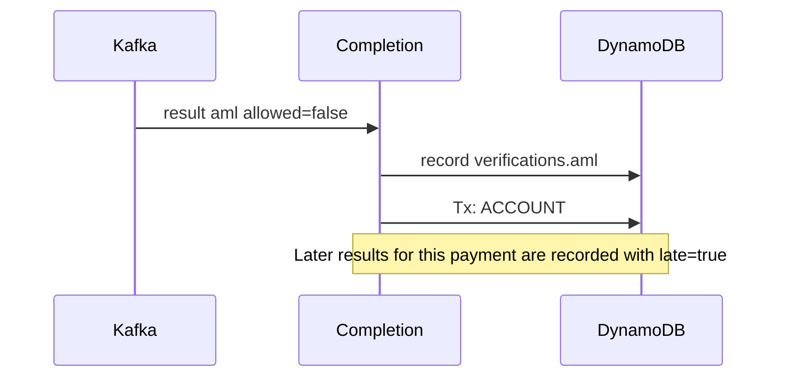

### 9.5 User cancel (incl. race with execution)

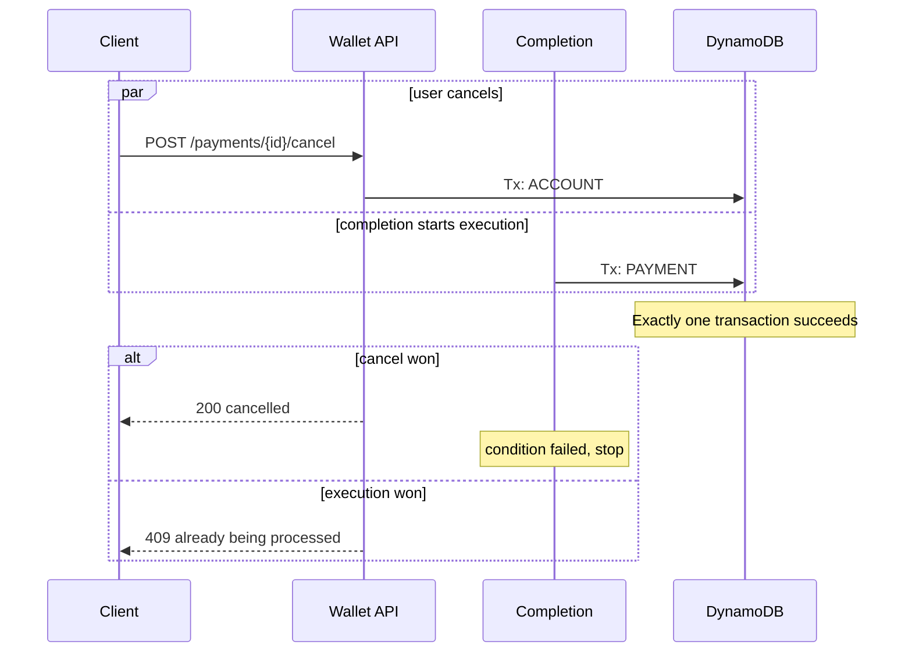

### 9.6 Verification timeout

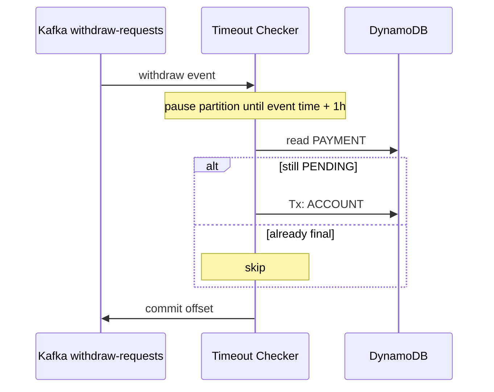

### 9.7 TransferService failure / unknown outcome

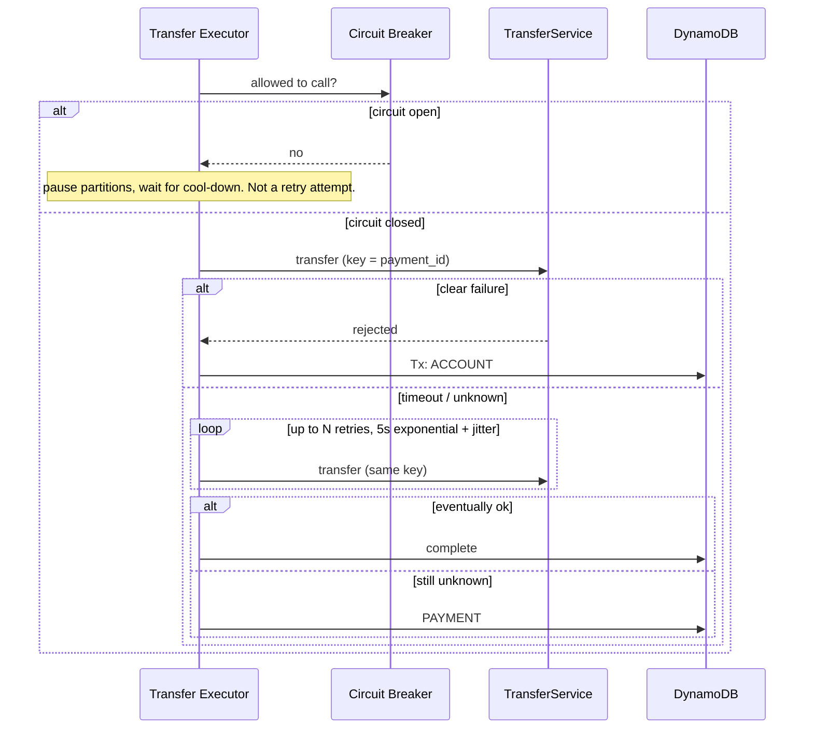

### 9.8 Concurrent results — reject can't be skipped

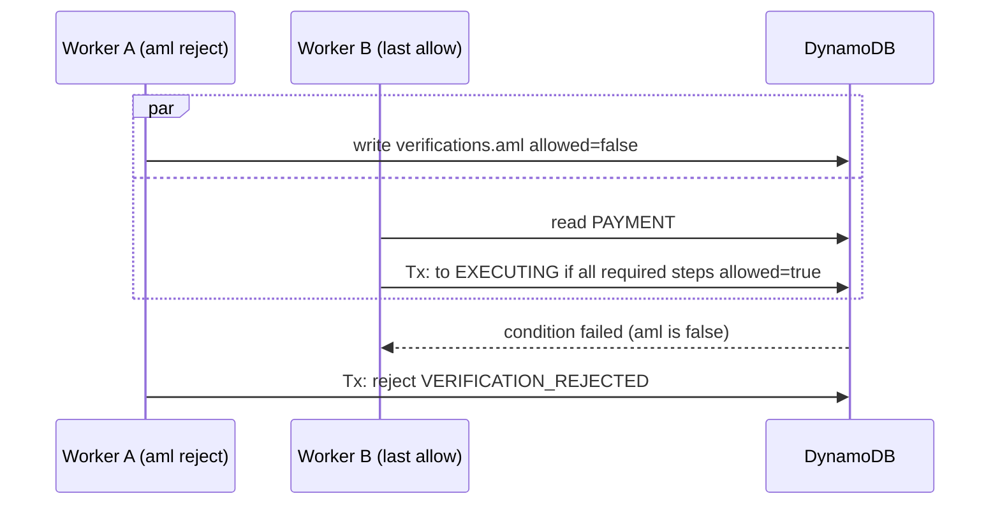

### 9.9 Account blocked by AML

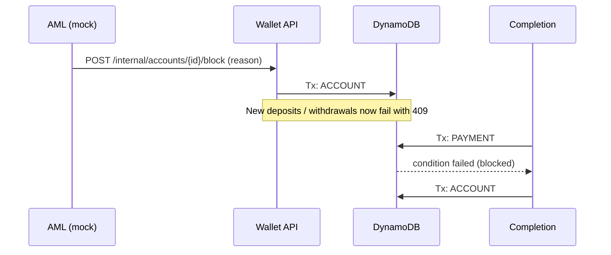

---

## 10. REST API

| Endpoint | Success | Notes |
|---|---|---|
| `POST /accounts` | 201 | `account_created` |
| `POST /accounts/{id}/deposits` | 201 | instant, final |
| `POST /accounts/{id}/withdrawals` | 202 + `payment_id` | async |
| `POST /payments/{payment_id}/cancel` | 200 | only while `PENDING` |
| `GET /payments/{payment_id}` | 200 | status, verifications, timestamps |
| `GET /accounts/{id}` | 200 | balance, status |
| `GET /accounts/{id}/ledger` | 200 | paged, newest first, `before_seq` and `limit` (no GSI, plan 3.2) |
| `POST /internal/accounts/{id}/block` | 200 | internal (AML) |
| `POST /internal/accounts/{id}/unblock` | 200 | internal |

- All POSTs require `Idempotency-Key`.
  - Same key + same body → stored response.
  - Same key + different body → `409`.
- Withdraw body: `amount`, `currency`, `beneficiary_id` only. Wallet fetches beneficiary snapshot itself (never trust client-sent masked/fingerprint).
- Deposit body: `amount`, `currency`, `external_tx_id`, `payer`.

Immediate errors (no ledger entry written):

| Code | When |
|---|---|
| 400 | invalid amount / currency |
| 404 | unknown account / payment |
| 409 | account blocked, payment not cancellable, idempotency key reused with different body |
| 422 | insufficient funds |
| 503 | optimistic lock retries exhausted — try again |

- Failed requests are not ledger entries. Log them separately (useful for AML later).

---

## 11. Configuration

| Setting | Default |
|---|---|
| Verification steps (list) | e.g. `aml`, `account_verified`, `beneficiary_credibility` |
| Verifier mock latency range | configurable |
| Verification timeout | 1h |
| Transfer retries | 5 (range 3–5) |
| Transfer initial delay | 5s, exponential, jitter |
| Optimistic lock retries | 3 |
| Workers per instance (completion, executor) | configurable |
| Worker queue size (backpressure) | configurable |
| `max.poll.records` | small, e.g. 50 |
| Circuit breaker failure threshold / cool-down | configurable |
| Kafka partitions per topic | 64–128 |
| Idempotency TTL | 24h |
| Default currency | USD |

All time values must be configurable so tests can use seconds.

---

## 12. Invariants (check in tests)

- Balance never negative.
- Replaying an account's ledger = `ACCOUNT#` balance.
- Ledger `seq` gap-free per account, starting at 1.
- Each payment has exactly one final event.
- Ledger entries never updated or deleted.
- Same idempotency key never produces two operations.

---

## 13. Testing

- Testcontainers:
  - DynamoDB Local: DynamoDB + Streams
  - Kafka (or Redpanda)
  - WireMock or in-process stubs: TransferService, Beneficiary, verifiers, AML
- Bridge runs as an in-test loop over the DynamoDB Local stream.
- Short timeouts/delays via config.
- Key scenarios:
  - Concurrent withdrawals on one account → no negative balance
  - Ledger replay matches balance
  - Retried request with same idempotency key → one operation
  - Cancel vs. execute race → one winner
  - Verification rejected → refund
  - Verification timeout → refund
  - Late verification result → recorded with `late: true`, no action
  - Account blocked mid-flight → rejected `ACCOUNT_BLOCKED`
  - TransferService clear failure → refund
  - TransferService unknown → `NEEDS_REVIEW`, no refund
  - Duplicate Kafka messages → no double effects
  - Crash during transfer → resumes with same key
  - Reject and last allow processed concurrently → never executed
  - Config change mid-flight → in-flight payment still uses its stored `required_steps`
  - Rebalance mid-processing (add/remove instance) → no double effects, nothing lost
  - Offset tracker: out-of-order completion → commits only contiguous offsets
  - Worker queues full → partitions paused, no rebalance
  - TransferService down → circuit opens, payments wait, no `NEEDS_REVIEW`; recovers after cool-down

---

## 14. Known risks / TODO

- **Deposit → instant withdraw gap.** AML reads deposits async and may lag. Accepted for now. Options later: hold period on fresh deposits, or AML catch-up check.
- **Reconciliation job** — TODO. Replay ledgers vs. balances; compare with TransferService.
- **`NEEDS_REVIEW` resolution** — TODO (manual or reconciliation).
- **Alerting (Grafana)** — future. Main risk: DynamoDB Streams keeps 24h only; bridge down longer = lost events.
- **Cost analysis** — later. Transactions cost 2× WCU; check AWS quotas.
- **Hot accounts** — assumed not to exist. If they appear: optimistic locking caps one account at roughly 50–100 ops/sec.
- **Partition count** — hard to increase later (keys remap). Pick generously up front.
- **Long circuit-open periods** — approved payments wait in `EXECUTING` and can't be cancelled. Consider an alert on time spent in `EXECUTING`.
- **Read model in Postgres (CQRS)** — future option for flexible history queries.
- **Deposit reversals / chargebacks** — not supported. Would be the only way to go negative.
- **Open question:** allow user cancel on a blocked account? Proposed: yes (money returns to the frozen account).

---

## 15. Deployment on EKS

Design fits Kubernetes as-is: services are stateless, state lives in DynamoDB and Kafka. Notes below.

### 15.1 Workloads

| Component | K8s workload | Scaling |
|---|---|---|
| Wallet API | Deployment | HPA on CPU / request rate |
| Verifiers (mocks) | StatefulSet | replicas ≤ partitions of `withdraw-requests` |
| Completion service | StatefulSet | KEDA on lag, replicas ≤ partitions |
| Transfer executor | StatefulSet | KEDA on lag, replicas ≤ partitions |
| Timeout checker | StatefulSet | fixed replicas (lag ~1h is normal, don't lag-scale) |
| Bridge | Lambda (outside cluster) | managed by AWS |

- Kafka consumers run as StatefulSets → stable pod names → stable `group.instance.id` for static membership.

### 15.2 AWS integration

- **AWS access:** EKS Pod Identity (or IRSA). One IAM role per service, least privilege.
- **Kafka:** Amazon MSK with IAM auth (same pod roles).
- **Ingress:** AWS Load Balancer Controller → ALB for the Wallet API.
- **Nodes:** Karpenter. If using Spot: PodDisruptionBudgets + graceful shutdown are critical (2 min notice).
- **Metrics:** Amazon Managed Prometheus + Managed Grafana.

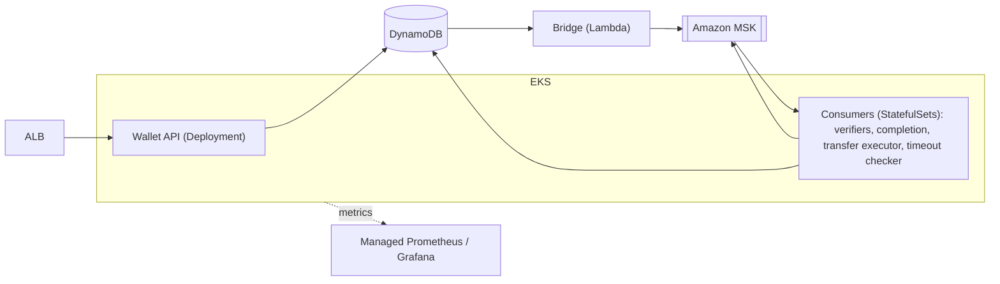

### 15.3 Rules for consumer pods

- **Graceful shutdown (SIGTERM):** stop polling → let workers finish → commit offsets → exit.
  - Set `terminationGracePeriodSeconds` to cover normal in-flight work.
  - Transfer executor: abandon retry loops on shutdown; payment is redelivered (safe via idempotency key).
- **Session timeout** longer than a typical pod restart, so restarts don't trigger rebalances.
- **Liveness probe:** checks the poll loop is alive, not that work progresses. Paused partitions (circuit open, full queues) must not cause restarts.
- **Readiness probe:** Wallet API only (DynamoDB reachable).
- **Autoscaling:** long stabilization windows to avoid flapping (each scale event = rebalance).
- **PodDisruptionBudgets** for every consumer, so node upgrades don't remove all replicas at once.

### 15.4 Observability (Prometheus)

**General rules**
- Apps expose `/metrics` (e.g. via Micrometer or the Prometheus client). Scraped by Managed Prometheus.
- AWS-side metrics (CloudWatch) imported via a CloudWatch exporter (e.g. YACE).
- Never use `account_id`, `payment_id` or raw URLs as labels (too many values). Use route templates like `/accounts/{id}/withdrawals`.
- Latencies = histograms. Rates = counters + PromQL `rate()`.

**Where each metric comes from**

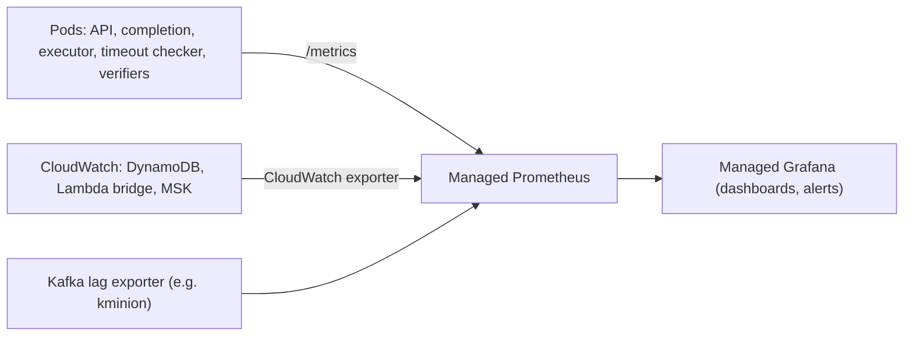

**1. HTTP traffic (Wallet API)**
- `http_server_requests_seconds` — histogram. Labels: `method`, `route`, `status`.
- Gives request rate, error rate and latency per endpoint.

**2. DynamoDB latency**
- App side: `dynamodb_request_seconds` — histogram. Labels: `operation` (GetItem, TransactWriteItems, Query, UpdateItem), `outcome` (ok, conditional_failed, transaction_conflict, throttled, error), `service`.
- AWS side: CloudWatch `SuccessfulRequestLatency`, `ThrottledRequests`, consumed capacity → via exporter.

**3. DynamoDB Stream lag**
- Bridge is a Lambda (can't be scraped). Use:
  - CloudWatch `IteratorAge` of the Lambda → via exporter.
  - Custom metric `bridge_stream_lag_seconds` (now − record creation time), published as CloudWatch embedded metric → via exporter.
- Alert well before the 24h Streams retention (e.g. > 5 min).

**4. Kafka lag**
- Kafka lag exporter (e.g. kminion) or MSK consumer lag metrics.
- `kafka_consumer_group_lag` (messages) and time lag (seconds). Labels: `group`, `topic`, `partition`.
- Timeout checker group excluded from lag alerts (~1h lag is normal).

**5. End-to-end processing time**
- Wallet API stores `received_at` (when the HTTP request arrived) on `PAYMENT#`.
- Deposits (synchronous): `http_server_requests_seconds` for the deposit route covers request received → transaction committed, by `status`.
- Withdrawals: `withdrawal_end_to_end_seconds` — histogram, `finalized_at − received_at`.
  - Recorded by whichever component writes the final status (executor, completion, timeout checker, API on cancel).
  - Labels: `outcome` (completed, rejected, cancelled, needs_review), `reason` (for rejected).
- Stage breakdown (histograms, to find where time goes):
  - `http_server_requests_seconds` for the withdrawal route - request received → `withdraw` committed (API)
  - `bridge_stream_lag_seconds` — committed → published to Kafka (bridge)
  - `verification_step_seconds` — per step, request → result. Label: `step`
  - `withdrawal_verification_seconds` — `withdraw` committed → `EXECUTING` (completion)
  - `transfer_seconds` — `EXECUTING` → final (executor). Label: `outcome`
- Pod clocks are NTP-synced on EKS; small skew is acceptable.

**6. Rates (counters)**
- `api_errors_total` — labels: `route`, `error` (insufficient_funds, account_blocked, not_cancellable, idempotency_mismatch, lock_retries_exhausted, invalid_request, not_found)
- `optimistic_lock_retries_total` — labels: `service`
- `late_verification_results_total` — labels: `step`
- Counts already covered by another metric are not separate counters:
  - finalized withdrawals: `withdrawal_end_to_end_seconds_count`, labels `outcome`, `reason`
  - deposits, accepted withdrawals, account blocks: `http_server_requests_seconds_count` by route and status (includes idempotent replays)
  - transfer attempts: `http_client_requests_seconds_count{uri="/transfers"}` by status (2xx ok, 422 failed, anything else unknown)

**7. Internal health (gauges)**
- `worker_inflight` (records being processed), `worker_queue_depth` (polled, not yet handed to a worker) - labels: `service`
- `worker_paused_partitions` - labels: `service`, `reason` (not_due, backpressure, uncommitted_cap, circuit_open)
- `circuit_breaker_state` — 0 closed, 1 half-open, 2 open
- `payments_executing` and oldest age in `EXECUTING`
- `payments_needs_review` count

Gauges based on DynamoDB counts (`EXECUTING`, `NEEDS_REVIEW`) need a periodic query or a small counter scheme. Detail left to implementation.

**8. Built-in vs custom (Spring Boot 4)**

| Metric area | Source |
|---|---|
| HTTP request stats | built-in (`http.server.requests`); enable percentile histograms in config |
| JVM, GC, threads, CPU, process, logging | built-in |
| Kafka client metrics (fetch, client-side lag, producer sends/errors) | Micrometer `KafkaClientMetrics` bound in the worker pool and the acked producer; most are turned off in `management.metrics.enable` |
| Tracing | built-in Micrometer Tracing + OpenTelemetry exporter (check exact starter for Boot 4) |
| Circuit breaker, retries | Resilience4j → Micrometer (automatic) |
| DynamoDB latency | **custom**: AWS SDK v2 `MetricPublisher` or `ExecutionInterceptor` → Micrometer |
| Worker pool (queue depth, in-flight, paused partitions, oldest uncommitted offset age) | **custom** |
| Business metrics (sections 5, 6) | **custom** |
| Consumer group lag (authoritative) | **external**: lag exporter, e.g. kminion (client-side lag vanishes when a consumer is down) |
| DynamoDB Streams lag, Lambda bridge, DynamoDB server-side, MSK | **external**: CloudWatch → exporter |

- Java 25 note: if the worker pool uses virtual threads, per-key ordering must stay explicit — one queue per worker keyed by `payment_id`. A virtual-thread-per-task executor does not preserve order.

---

## 16. Future: multi-region (not in scope now)

Current design = one region. Notes for later.

**Why it doesn't work as-is**
- DynamoDB Global Tables replicate async (~1s), last writer wins.
- Conditional writes and transactions are checked per region only.
- Same account written in two regions → possible negative balance and overwritten `LEDGER#<seq>` (lost entry).
- Strongly consistent multi-region Global Tables exist, but check whether they support transactions before relying on them.

**Approach: home region per account ("cells")**
- Each account owned by one region. All writes go there; other regions forward.
- Each region runs a full copy of the system for its accounts.
- Global Tables used for local reads and disaster recovery only.

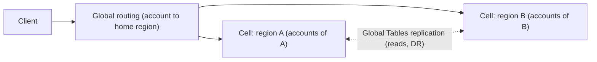

**Things to solve**
- **Failover:** fence the old region before another takes over. Accept a small data-loss window and reconcile. Prefer manual failover for money.
- **Streams:** each region sees replicated items too. Bridge publishes only writes made in its own region.
- **Kafka:** one cluster per region. Cross-region mirroring only for global consumers (AML, reporting).
- **Idempotency:** routing to home region keeps keys in one place.
- **Background workers:** completion, transfer executor and timeout checker act only on their region's payments.
- **Non-technical:** data residency rules (may force home region by country), per-country licensing, multiple currencies and FX.
